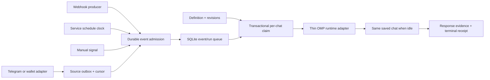

# Architecture

The agent manages behavior, not listener implementation. It sees one current-chat tool and one editable saved prompt. Source adapters own provider authentication, filtering and provider-specific delivery semantics.

## Records

- **Definition**: immutable ID, name, canonical saved-file/cwd binding, source specification, enabled/deleted state, trusted prompt, revision, queue policy and deadlines. Webhook credentials are independent of editable content.
- **Revision**: saved prompt, source settings, policy and change time. Prompt changes use an optional compare-and-swap `expectedRevision`.
- **Event**: stable producer ID, type, JSON payload, content fingerprint and durable intake time. Dedup is independent of retained detailed history.
- **Run**: one queued execution, event identity, frozen revision at claim, runtime owner, lifecycle timestamps and response evidence. Coalesced events can share a run while retaining their own dedup receipt.
- **Runtime lease**: a single owner for a canonical saved-file/cwd binding. Only that owner claims/acknowledges its runs. Dead runtime ownership makes inflight work uncertain, never silently replayable. A missed heartbeat alone never permits takeover of a still-live OMP process. Ownership survives a service restart.

SQLite is imported only by the standalone Node service. OMP's native/Bun host uses authenticated loopback HTTP and has no SQLite compatibility requirement. The control credential is separate from all webhook credentials; producer credentials cannot invoke management or choose a session. A reverse proxy must expose only the event route, not management.

## Atomic boundaries

Event admission and dedup receipt creation commit together. A schedule's next due time advances in the same transaction as event admission. Queue claim and revision selection commit together. Acknowledgment updates run evidence and all attached dedup receipts together. The Telegram adapter captures event plus contiguous source cursor atomically in its own SQLite outbox before attempting HTTP.

The service does not claim atomicity across SQLite and arbitrary external actions. If OMP loses contact after sending a transaction or message, replay could duplicate an effect. Hence uncertain execution requires evidence reconciliation; source intake retries remain safe with the same event ID and identical payload.

## Host lifecycle

A runtime polls admission at 250 ms while the chat is idle and serializes all sources through the existing OMP dispatch lane. It does not interrupt an interactive/RPC turn. A timeout quarantines the lane until terminal settlement or shutdown, preventing a late answer from being assigned to another request.

`message_end` happens before OMP appends the message. Its current leaf can still be the user prompt. The adapter records a final response digest immediately, then identifies its persisted assistant entry at terminal/shutdown by checking timestamp and digest against the bound session's branch. It does not use an unverified leaf ID. `responded` and `settled` remain distinct.

Explicit reconciliation reads the bound saved JSONL without modifying it. It checks a run/receipt marker in the user prompt and follows parent links from a saved final assistant reply. An intervening interactive user prompt breaks attribution. Missing/ambiguous evidence stays unresolved. This is not a claim that the requested external action succeeded.

## Limits

This is a single-machine service, not a distributed workflow platform. The open OMP chat owns inference and its existing provider/model settings. Offline signals are retained, but the service does not autonomously spawn a headless OMP session. There is no cross-chat routing, provider subscription provisioning, graphical workflow editor, DAG engine or exactly-once guarantee for external effects. Telegram is a supplied adapter; wallet/blockchain watchers remain provider-specific sources emitting the same envelope.

The legacy scheduler/inbox modules remain for migration fixtures and explicit `legacyBackend` embedders. The shipped OMP extension uses only the new service and compatibility facades, not a second live scheduler.
